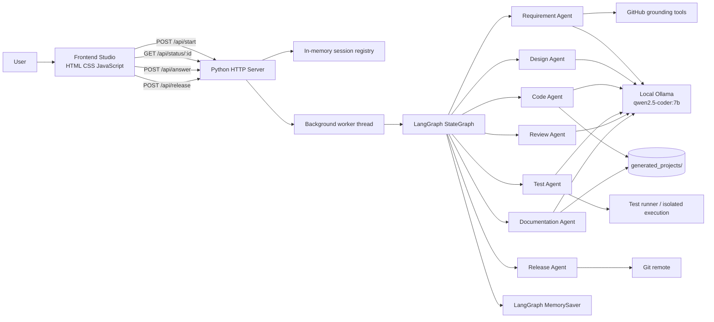
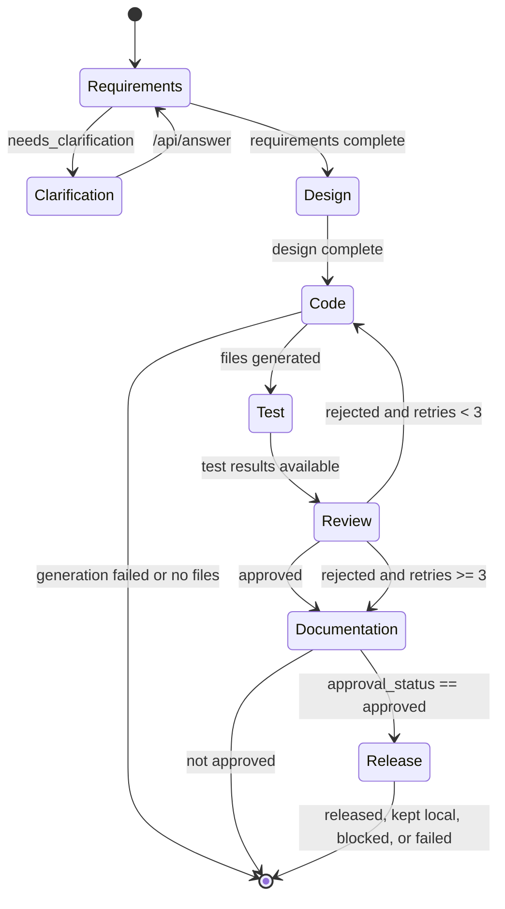
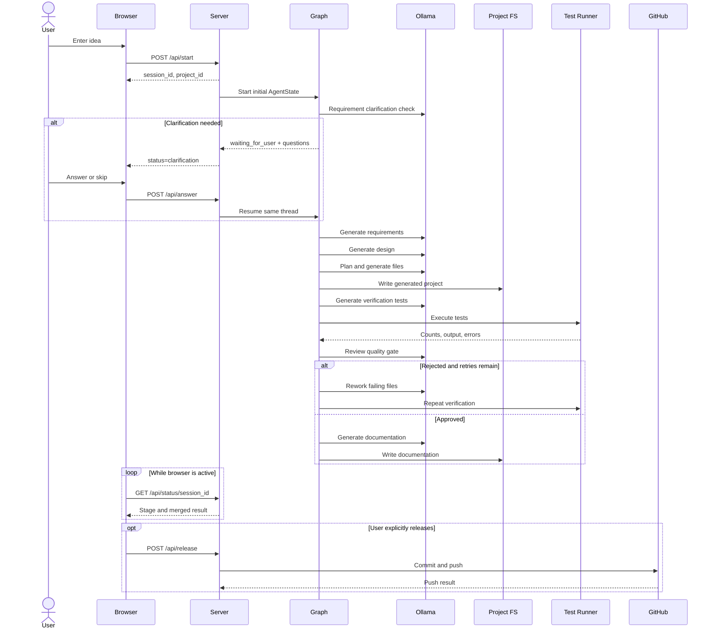
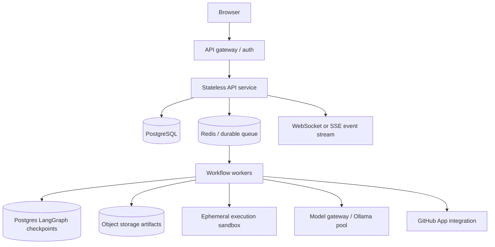
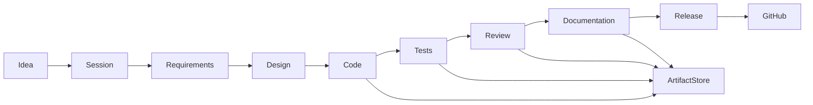

# IdeaToProduct System Design

## 1. Purpose and scope

IdeaToProduct converts a natural-language product idea into a reviewed software
project. The system is an agentic software-development lifecycle (SDLC)
orchestrator with:

- A browser-based product engineering studio.
- A Python HTTP backend.
- A LangGraph workflow that coordinates specialist agents.
- Local Ollama language-model inference.
- Deterministic validation and sandboxed test execution.
- Filesystem-based generated project artifacts.
- Optional, explicitly triggered GitHub release.

This document describes the current implementation in this repository and the
recommended production architecture. Current behavior is marked **Implemented**;
future hardening is marked **Recommended**.

## 2. Product goals

### Functional goals

1. Accept a product idea from a user.
2. Ask a small number of clarification questions when the idea is ambiguous.
3. Convert the idea into traceable requirements.
4. Produce an architecture and technology design.
5. Generate runnable source code.
6. Generate independent verification tests and execute them.
7. Review requirements, design, code, tests, security, and documentation as a
   quality gate.
8. Rework code when the quality gate rejects it.
9. Generate project documentation after the gate.
10. Release only after approval and an explicit release action.

### Non-functional goals

- Keep every artifact traceable to the project and workflow stage.
- Prevent generated code from silently bypassing validation.
- Make failures visible to the user.
- Keep test execution isolated from the backend process.
- Avoid releasing unapproved or partially generated projects.
- Preserve artifacts when release fails.
- Support frontend-only, backend, CLI, and compiled-language projects where the
  generated test runner supports the selected stack.

## 3. High-level architecture



### Current deployment shape

The current system is intentionally lightweight:

- `server.py` serves the static frontend and API from one Python process.
- `HTTPServer` handles requests.
- Pipeline work runs in daemon threads so HTTP polling remains responsive.
- Sessions are stored in a process-local dictionary protected by a lock.
- LangGraph uses `MemorySaver`, also process-local.
- Generated files are written beneath `generated_projects/<project_id>/`.
- Ollama is expected at `OLLAMA_BASE_URL`, defaulting to
  `http://localhost:11434`.

This is suitable for local development and demos. It is not yet a
multi-instance production deployment because sessions, checkpoints, and
generated artifact metadata are not durable or shared.

## 4. Repository responsibilities

| Area | Responsibility |
| --- | --- |
| `frontend/index.html` | Landing page, project brief form, studio layout, dialogs |
| `frontend/style.css` | Responsive visual design and stage/status styling |
| `frontend/app.js` | API client, polling, studio state, stage rendering, review/release UI |
| `server.py` | Static file serving, API routing, session lifecycle, worker threads |
| `Agents/graph.py` | LangGraph nodes, conditional routing, checkpointed workflow |
| `Agents/State_definition.py` | Shared `AgentState` data contract |
| `Agents/*Agent.py` | Specialist agent implementations |
| `Agents/prompts/` | Role-specific system prompts |
| `Agents/skills/` | Stack and domain guidance injected into prompts |
| `Agents/imports.py` | LLM construction, prompt loading, structured-output fallback |
| `Agents/tools.py` | Grounding, project scaffolding, and utility tools |
| `Agents/test_runner.py` | Multi-stack generated-project test execution |
| `generated_projects/` | Generated source projects and persisted stage artifacts |

## 5. Core workflow



The workflow entry point is `requirement`. The graph uses partial state
updates: each node returns only the fields it owns, and LangGraph merges those
updates into the checkpointed state.

## 6. Shared state contract

`AgentState` is the workflow's canonical contract.

### Project identity

- `project_id`: generated project identifier.
- `user_id`: current user identifier; currently a fixed local/demo value.
- `idea`: original product brief.

### Requirements and grounding

- `clarification_questions`
- `user_answers`
- `clarification_round`
- `requirements`
- `requirements_version`
- `github_evidence`

### Design

- `design`
- `design_version`

### Code

- `code`
- `code_version`
- `generated_project_path`

### Testing, review, documentation, and release

- `test_results`, `test_version`
- `review`, `review_version`
- `documentation`, `documentation_version`
- `release`, `release_version`

### Workflow control

- `current_stage`
- `workflow_status`
- `retry_count`
- `approval_status`

Version fields provide a basic audit trail. A production implementation should
also add immutable stage-run records containing timestamps, model identifiers,
prompt versions, input/output hashes, duration, and error information.

## 7. Agent specifications

### 7.1 Requirement Agent

**Input**

- `idea`
- Previous `user_answers`
- Current clarification round

**Processing**

1. Creates the requirement LLM using the configured Ollama model.
2. Checks whether clarification is needed.
3. Allows at most two clarification rounds.
4. Treats an answer containing `skip` as permission to use defaults.
5. Calls GitHub grounding to find real issue patterns and edge cases.
6. Generates structured requirements using Pydantic validation.

**Output**

- Problem statement and objectives.
- Actors and user stories.
- Functional and non-functional requirements.
- Acceptance criteria.
- Constraints, assumptions, scope boundaries, and open questions.
- GitHub evidence.

**Conditions**

| Condition | Result |
| --- | --- |
| Clarification required | Sets `workflow_status=waiting_for_user` and stops at the clarification boundary |
| User answers `/api/answer` | Resumes the same LangGraph thread |
| User skips or two rounds reached | Continues with standard assumptions |
| Requirements generated | Routes to Design |
| LLM structured output fails | Current implementation raises an error; the worker reports `status=error` |

### 7.2 Design Agent

**Input**

- Structured requirements.

**Processing**

1. Requests a structured architecture design.
2. Uses a deterministic fallback design if the design LLM is unavailable.
3. Normalizes contradictions before handing the result to Code Agent.

**Output**

- System type and architecture description.
- Components and responsibilities.
- Data entities and relationships.
- API endpoints and error cases.
- Technology choices and supporting libraries.
- Design decisions and edge cases.

**Consistency rules**

- If a framework such as React, Vue, Svelte, Angular, Next, or Nuxt is not
  explicitly required and cannot be built in the test environment, it is
  normalized to plain HTML/CSS/JavaScript.
- If no backend is selected, API endpoints and database choices are removed.
- Every automatic normalization is recorded as a design decision.

### 7.3 Code Agent

**Input**

- Requirements.
- Normalized design.
- Previous code artifact, review defects, and failing test output during rework.

**Processing**

1. Generates a compact file plan.
2. Generates source files individually as plain text.
3. Validates syntax, JSON, HTML completeness, JavaScript syntax, and
   placeholder/truncation markers.
4. Repairs invalid files up to the configured repair limit.
5. On rework, reuses the previous plan and changes only selected files where
   possible.
6. Writes the project using `repo_scaffold`.

**Output**

- `files`: path, content, purpose, exports, and traceability IDs.
- Run and test commands.
- Dependencies.
- Implementation notes.
- `generated_project_path`.

**Conditions**

| Condition | Result |
| --- | --- |
| Valid files generated | Routes to Test |
| Provider error or no files | Sets failed workflow state and ends before testing |
| Validation failure | Attempts file-level repair |
| Review rejection | Receives actionable defects and test output, then reworks |
| Third rejection | Review router stops rework and preserves artifacts for documentation |

### 7.4 Test Agent

**Input**

- Requirements and acceptance criteria.
- Design edge cases and interfaces.
- Generated source files.
- Prior tests and prior test results.

**Processing**

1. Detects the project stack from file extensions/manifests.
2. Selects stack-specific test conventions.
3. Generates an independent verification test file.
4. Reuses tests during code rework so the target does not move.
5. Validates and repairs the test file before blaming application code.
6. Runs the tests through the test runner.
7. Stores counts, output, errors, duration, and test files.

**Supported execution paths**

| Stack | Test convention |
| --- | --- |
| JavaScript/frontend | CommonJS, Node built-in `node:test`, `node:assert`, `node:fs` |
| Go | `go test` and standard `testing` |
| Java | Maven/JUnit convention |
| C | C test harness compiled with project sources |
| Python/default | `pytest` or project-provided command |

**Conditions**

- No code files: returns an explicit failed test result.
- Test generation fails: records a test-side error and can attempt repair.
- Test process timeout: records an infrastructure/test-runner error.
- Test failures: Review must reject the project.
- All tests pass: Review may approve if all other gates pass.

### 7.5 Review Agent

**Input**

- Idea, requirements, design, code, test results, and code notes.

**Processing**

1. Performs a structured quality gate across Requirements, Design,
   Implementation, Tests, Security, and Documentation.
2. Produces checks, findings, defects, feedback, summary, and score.
3. Uses a deterministic fallback if the review model fails.
4. Forces rejection when tests fail, even if the model says approved.
5. Uses score > 5 as the approval threshold.

**Output and routing**

| Review outcome | Router action |
| --- | --- |
| `approval_status=approved` | Documentation |
| Rejected, code retries < 3 | Code rework |
| Rejected, code retries >= 3 | Documentation with preserved artifacts |

The review prompt requires defects to be actionable, for example:
`app.py: POST /api/items accepts invalid input; return a 4xx response (AC-03).`

### 7.6 Documentation Agent

**Input**

- Idea, requirements, design, code summary, test results, and review.

**Output**

- `README.md`
- `API_REFERENCE.md`
- `ARCHITECTURE.md`
- `USER_GUIDE.md`
- `CHANGELOG.md`

The files are written into the generated project directory. If review approval
was preserved after the retry limit, documentation still records the state;
release remains gated by `approval_status`.

### 7.7 Release Agent

**Trigger**

- Automatic graph route after approved documentation, or explicit
  `POST /api/release` from the studio.

**Governance**

- Requires `approval_status == approved`.
- The HTTP release endpoint requires the pipeline to be idle and a repository
  URL either in the request or `GITHUB_REPO_URL`.

**Processing**

1. Resolves the generated project directory.
2. If no GitHub token exists, keeps the project local.
3. Otherwise initializes Git if needed, configures identity, sets the remote,
   commits, and pushes.
4. Deletes the local project only after a successful push.

**Outcomes**

| Outcome | Meaning |
| --- | --- |
| `blocked` | Governance approval is missing |
| `not_found` | Generated project directory is missing |
| `kept_local` | No GitHub credentials; local artifact is preserved |
| `success` | Push completed and local folder was removed |
| `failed` | Push/configuration failed; local files are preserved |

## 8. Backend API design

### `POST /api/start`

Starts a new workflow.

Request:

```json
{
  "idea": "A habit tracker with daily goals and streaks",
  "project_id": "optional-custom-id"
}
```

Success response:

```json
{
  "session_id": "uuid",
  "project_id": "proj_a1b2c3",
  "status": "running"
}
```

Invalid or empty ideas return HTTP 400.

### `GET /api/status/<session_id>`

Returns current session and latest merged agent result.

```json
{
  "session_id": "uuid",
  "project_id": "proj_a1b2c3",
  "is_running": true,
  "status": "running",
  "stage": "code",
  "error": null,
  "result": {}
}
```

Possible session statuses:

- `running`
- `clarification`
- `done`
- `error`

Unknown sessions return HTTP 404.

### `POST /api/answer`

Resumes a clarification checkpoint.

```json
{
  "session_id": "uuid",
  "answers": ["Use local storage and no login for V1"]
}
```

The server pairs answers with the currently displayed questions, appends them
to `user_answers`, and resumes the same LangGraph thread.

### `POST /api/release`

Starts an explicitly requested release.

```json
{
  "session_id": "uuid",
  "repo_url": "https://github.com/example/generated-product.git"
}
```

Returns HTTP 202 when release starts. Returns HTTP 409 while the pipeline is
running, HTTP 400 when no repository URL is available, and HTTP 404 for an
unknown session.

### Static frontend routes

- `/` serves `frontend/index.html`.
- JavaScript and CSS are served from `frontend/`.
- HTML, JS, and CSS responses disable browser caching during development.
- CORS currently allows all origins.

## 9. Frontend behavior

### Landing screen

1. User enters a brief, limited to 800 characters.
2. Example ideas can populate the textarea.
3. `launchPipeline()` calls `/api/start`.
4. The UI switches to the studio and begins polling.

### Studio screen

The frontend maintains a separate browser state object containing session ID,
project ID, current view, pipeline data, activity log, and polling timer.

It renders:

- Pipeline stage progress.
- Live activity feed.
- Requirements and design views.
- Generated source files.
- Test summary and raw results.
- Review verdict, findings, and defects.
- Documentation previews.
- Release status.

### Polling

The browser polls `GET /api/status/<session_id>`, updates the stage and result,
and stops polling when the backend reports a terminal state. If the backend
reports `clarification`, the frontend shows the question dialog and sends
answers through `/api/answer`.

### Error behavior

- Network/start errors are shown through an alert and the launch button is
  re-enabled.
- Backend session errors are rendered as pipeline errors.
- Release errors remain visible in the release view.
- HTML escaping is used when rendering generated values into the DOM.

## 10. End-to-end request sequence



## 11. Failure and conditional behavior matrix

| Failure/condition | Detection point | Behavior | Artifact policy |
| --- | --- | --- | --- |
| Empty idea | API boundary | HTTP 400; no workflow starts | None |
| Ambiguous idea | Requirement Agent | Pause with one question per round | Checkpoint retained |
| User skips clarification | API resume | Continue using defaults | Answers retained |
| Clarification limit reached | Requirement Agent | Continue without more questions | Existing answers retained |
| LLM structured response fails | Agent/model boundary | Agent-specific fallback where implemented; otherwise workflow error | Existing artifacts preserved |
| Design contradiction | Design normalization | Rewrite unsupported choices and record decisions | Normalized design retained |
| Code plan/file invalid | Code Agent | Repair file up to configured limit | Invalid output not released |
| Code generation returns no files | Code router | End workflow as failed | No test run |
| Test file invalid | Test Agent | Repair test file before application rejection | Test diagnostics retained |
| Tests fail | Test/Review | Review rejects and sends defects to Code Agent | Project retained for rework |
| Review rejects | Review router | Rework until 3 code retries | After limit, docs may be generated |
| Review LLM unavailable | Review Agent | Deterministic fallback review | Conservative gate |
| Test infrastructure failure | Test runner | Record explicit error; do not mislabel as code success | Logs retained |
| Documentation model fails | Documentation Agent | Current implementation raises and worker reports error | Generated source retained |
| Release without approval | Release Agent | `blocked_by_governance` | Local project retained |
| Missing GitHub token | Release Agent | `released_local` | Local project retained |
| Git push fails | Release Agent | `failed` | Local project retained |
| Successful push | Release Agent | `released` | Local project removed by current policy |

## 12. Security design

### Current controls

- Release requires an approved review state.
- Generated projects are written below a known workspace root.
- Test execution has timeouts and stack-specific commands.
- Generated code is syntactically validated before testing.
- Release credentials are read from environment variables, not generated files.
- Failed releases preserve files for diagnosis.
- Frontend uses escaped rendering for generated content.

### Current risks and recommended controls

| Area | Current behavior | Recommended hardening |
| --- | --- | --- |
| Authentication | No user authentication | Add identity provider and session ownership checks |
| Authorization | Any caller with a session ID can poll/answer/release | Bind every session to an authenticated user and authorize each action |
| CORS | Allows `*` | Restrict to known frontend origins |
| Input limits | Idea length is constrained in UI but not strongly at API level | Enforce server-side byte/character limits and JSON schema validation |
| Path traversal | Scaffold strips leading `/` but should reject `..` segments | Resolve paths and verify they remain under the project root |
| Code execution | Generated code is executed by local tools | Use isolated containers/VMs, non-root users, read-only base images, CPU/memory/process/network limits |
| Dependency installation | Test runner may install project dependencies | Use allowlists, locked dependencies, isolated network policy, and malware scanning |
| Prompt injection | User idea and GitHub evidence reach agents | Treat external text as untrusted data and delimit it in prompts |
| Secrets in generated code | Review checks for obvious secrets | Add secret scanning before persistence and release |
| Git URL/token handling | Token is embedded into an authenticated push URL in process memory | Use credential helpers or GitHub App tokens; never log URLs; scrub process/error output |
| Data retention | In-memory sessions and filesystem projects persist until cleanup | Add TTL, explicit deletion, encrypted object storage, and audit retention policy |
| SSRF | User-supplied repository URL is accepted | Validate allowed GitHub hosts and repository URL format |
| Observability data | Agent outputs may contain user source and prompts | Redact sensitive content before centralized logging |

## 13. Reliability and concurrency

### Current limitations

- `HTTPServer` is single-process and not suitable for horizontal scaling.
- Daemon threads can be terminated when the process exits.
- In-memory sessions disappear on restart.
- `MemorySaver` checkpoints are not durable.
- Concurrent answer/release actions need stronger state-transition checks.
- There is no worker queue, cancellation API, or heartbeat.

### Recommended production architecture



Recommended changes:

1. Replace process-local sessions with PostgreSQL rows and optimistic version
   checks.
2. Replace daemon threads with durable jobs and retryable workers.
3. Persist LangGraph checkpoints in a shared store.
4. Store source, test, logs, and documentation artifacts in object storage.
5. Publish stage updates over SSE or WebSockets; keep polling as a fallback.
6. Add cancellation and idempotency keys for start, answer, and release.
7. Add per-project locks so two releases or reworks cannot run concurrently.
8. Add cleanup jobs for expired sessions and failed temporary sandboxes.

## 14. Observability

Every stage should emit a structured event:

```json
{
  "event_id": "uuid",
  "session_id": "uuid",
  "project_id": "proj_a1b2c3",
  "stage": "test",
  "attempt": 1,
  "status": "completed",
  "started_at": "ISO-8601",
  "completed_at": "ISO-8601",
  "model": "qwen2.5-coder:7b",
  "prompt_version": "git-sha-or-file-version",
  "input_hash": "sha256",
  "output_hash": "sha256",
  "error_code": null
}
```

Track at least:

- End-to-end completion rate.
- Time per agent and per model call.
- Clarification frequency.
- Code repair count.
- Test pass/fail/infrastructure-failure counts.
- Review approval rate and retry distribution.
- Release success/failure rate.
- Token/input-output size and model latency.
- Sandbox resource usage.

Never log raw credentials, authenticated Git URLs, or unrestricted user/project
source in application logs.

## 15. Data lifecycle



Recommended retention rules:

- Keep the original idea, state transitions, and final decision for the audit
  period.
- Keep every rejected code iteration only when debugging or audit policy
  requires it.
- Expire temporary test sandboxes quickly.
- Do not delete local artifacts before a verified remote release.
- Make deletion explicit and report whether it succeeded.

## 16. Testing strategy for the platform

### Unit tests

- State initialization and version increments.
- Requirement clarification limits and skip handling.
- Graph router decisions.
- Design normalization rules.
- File validation and placeholder detection.
- Test result parsing.
- Release governance and path resolution.
- API request validation and status transitions.

### Integration tests

- Start a session and poll until completion.
- Pause at clarification and resume with answers.
- Simulate failed tests and verify review rejection.
- Verify code rework receives defects and test output.
- Verify three-retry give-up behavior.
- Verify documentation files are written.
- Verify release is blocked before approval.
- Verify failed Git pushes preserve the project directory.

### End-to-end tests

Use a deterministic fake model/provider and a temporary artifact root. Do not
make CI depend on a running local Ollama instance or public GitHub data.

### Security tests

- Path traversal in generated file paths.
- Oversized and malformed JSON payloads.
- Unauthorized session access.
- Repository URL allowlist bypasses.
- Secret leakage in logs and release errors.
- Sandbox escape attempts and network access.

## 17. Deployment profiles

### Local development

```text
Browser -> server.py -> local Ollama
                    -> generated_projects/
```

Use for demonstrations and development. Configure `OLLAMA_BASE_URL` and
`OLLAMA_MODEL` in `.env` as needed.

### Single-host staging

```text
Reverse proxy -> server process -> worker process -> isolated test runner
                                      |
                                      -> Ollama service
```

Add TLS, an allowlisted origin, process supervision, log rotation, and a
separate test execution user.

### Production

Use the durable architecture in section 13 with authenticated API access,
shared persistence, isolated execution, model quotas, artifact retention, and
auditable release approvals.

## 18. Implementation checklist

### Already implemented

- [x] LangGraph workflow with conditional routes.
- [x] Clarification checkpoint and resume flow.
- [x] Requirements, design, code, test, review, documentation, and release agents.
- [x] Structured Pydantic schemas for major agent outputs.
- [x] Design consistency normalization.
- [x] Generated-file validation and repair loops.
- [x] Independent generated test execution.
- [x] Review rejection loop with a retry cap.
- [x] Explicit approval gate before release.
- [x] Local fallback when GitHub credentials are absent.

### Recommended next increments

1. Add server-side request schemas and strict payload limits.
2. Add path traversal protection to `repo_scaffold`.
3. Move test execution to an isolated sandbox.
4. Persist sessions and checkpoints.
5. Add authentication, authorization, and restricted CORS.
6. Add structured event logging and metrics.
7. Add deterministic provider mocks for CI.
8. Add idempotency and cancellation.
9. Validate and allowlist release repository URLs.
10. Add secret scanning before release.

## 19. Architectural decisions

| Decision | Rationale |
| --- | --- |
| LangGraph for orchestration | Makes stage transitions and conditional rework explicit |
| Pydantic structured outputs | Gives agents machine-readable contracts |
| Local Ollama model | Keeps inference configurable and local for development |
| Independent test generation | Avoids allowing the code generator to define its own proof |
| Review as a separate agent | Separates implementation from quality-gate judgment |
| Filesystem project artifacts | Simple local development and easy inspection |
| Explicit release action | Prevents accidental publication of generated code |
| Preserve artifacts on release failure | Enables debugging and retry without regeneration |
| Plain frontend fallback | Keeps generated projects runnable in a dependency-light test environment |

## 20. Summary

IdeaToProduct is a sequential, checkpointed agent workflow wrapped by a small
browser studio. The normal path is:

```text
Idea
  -> Clarification (optional)
  -> Requirements + GitHub grounding
  -> Design + consistency normalization
  -> Code generation + deterministic validation
  -> Independent tests + execution
  -> Review gate
  -> Code rework loop (maximum three code retries)
  -> Documentation
  -> Explicit approved release
```

The design is intentionally conservative at the quality gate: missing code,
failed tests, and missing approval cannot be treated as success. The primary
production work is to make this same workflow durable, authenticated, isolated,
observable, and safe to run concurrently.
